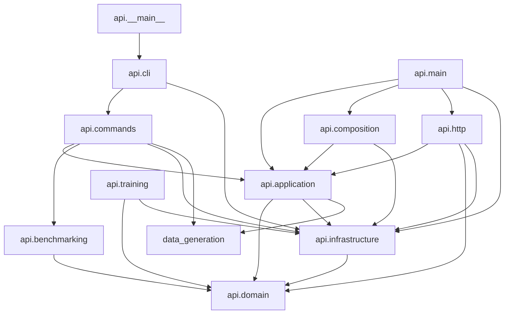

# Generated architecture diagrams

This file is generated from imports in `src/` and `frontend/ts/`.
Regenerate with `python scripts/generate_architecture_diagrams.py`; CI fails if it is stale.

## HLD: subsystem dependencies



## LLD: internal Python module dependencies

```mermaid
graph LR
    api___main__["api.__main__"] --> api_cli["api.cli"]
    api_application___init__["api.application.__init__"] --> api_application_container["api.application.container"]
    api_application_admin["api.application.admin"] --> api_domain_evidence["api.domain.evidence"]
    api_application_admin["api.application.admin"] --> api_infrastructure_bundles_release["api.infrastructure.bundles.release"]
    api_application_admin["api.application.admin"] --> api_infrastructure_observability_telemetry["api.infrastructure.observability.telemetry"]
    api_application_admin["api.application.admin"] --> api_infrastructure_persistence_audit["api.infrastructure.persistence.audit"]
    api_application_admin["api.application.admin"] --> api_infrastructure_persistence_manual_store["api.infrastructure.persistence.manual_store"]
    api_application_admin["api.application.admin"] --> api_infrastructure_persistence_operational_store["api.infrastructure.persistence.operational_store"]
    api_application_admin["api.application.admin"] --> api_infrastructure_process_admin_jobs["api.infrastructure.process.admin_jobs"]
    api_application_admin["api.application.admin"] --> api_infrastructure_process_progress["api.infrastructure.process.progress"]
    api_application_admin["api.application.admin"] --> api_infrastructure_runtime_performance["api.infrastructure.runtime.performance"]
    api_application_admin["api.application.admin"] --> data_generation_preview["data_generation.preview"]
    api_application_container["api.application.container"] --> api_application_admin["api.application.admin"]
    api_application_container["api.application.container"] --> api_application_dataset["api.application.dataset"]
    api_application_container["api.application.container"] --> api_application_matching["api.application.matching"]
    api_application_container["api.application.container"] --> api_application_queries["api.application.queries"]
    api_application_container["api.application.container"] --> api_application_review["api.application.review"]
    api_application_container["api.application.container"] --> api_application_search["api.application.search"]
    api_application_container["api.application.container"] --> api_infrastructure_bundles_release["api.infrastructure.bundles.release"]
    api_application_container["api.application.container"] --> api_infrastructure_bundles_repositories["api.infrastructure.bundles.repositories"]
    api_application_container["api.application.container"] --> api_infrastructure_observability_telemetry["api.infrastructure.observability.telemetry"]
    api_application_container["api.application.container"] --> api_infrastructure_persistence_audit["api.infrastructure.persistence.audit"]
    api_application_container["api.application.container"] --> api_infrastructure_persistence_decisions["api.infrastructure.persistence.decisions"]
    api_application_container["api.application.container"] --> api_infrastructure_persistence_operational_store["api.infrastructure.persistence.operational_store"]
    api_application_container["api.application.container"] --> api_infrastructure_runtime_resource_manager["api.infrastructure.runtime.resource_manager"]
    api_application_dataset["api.application.dataset"] --> api_domain_evidence["api.domain.evidence"]
    api_application_dataset["api.application.dataset"] --> api_infrastructure_observability_telemetry["api.infrastructure.observability.telemetry"]
    api_application_dataset["api.application.dataset"] --> api_infrastructure_read_model_dataset_query["api.infrastructure.read_model.dataset_query"]
    api_application_matching["api.application.matching"] --> api_application_matching_runtime["api.application.matching_runtime"]
    api_application_matching["api.application.matching"] --> api_domain_evidence["api.domain.evidence"]
    api_application_matching["api.application.matching"] --> api_domain_features["api.domain.features"]
    api_application_matching["api.application.matching"] --> api_domain_normalize["api.domain.normalize"]
    api_application_matching["api.application.matching"] --> api_infrastructure_matching_scoring["api.infrastructure.matching.scoring"]
    api_application_matching["api.application.matching"] --> api_infrastructure_observability_telemetry["api.infrastructure.observability.telemetry"]
    api_application_matching["api.application.matching"] --> api_infrastructure_persistence_operational_store["api.infrastructure.persistence.operational_store"]
    api_application_matching["api.application.matching"] --> api_infrastructure_retrieval_bundle_retrieval["api.infrastructure.retrieval.bundle_retrieval"]
    api_application_matching["api.application.matching"] --> api_infrastructure_runtime_engine["api.infrastructure.runtime.engine"]
    api_application_matching_runtime["api.application.matching_runtime"] --> api_domain_evidence["api.domain.evidence"]
    api_application_matching_runtime["api.application.matching_runtime"] --> api_infrastructure_bundles_release["api.infrastructure.bundles.release"]
    api_application_matching_runtime["api.application.matching_runtime"] --> api_infrastructure_bundles_request_context["api.infrastructure.bundles.request_context"]
    api_application_matching_runtime["api.application.matching_runtime"] --> api_infrastructure_matching_scoring["api.infrastructure.matching.scoring"]
    api_application_matching_runtime["api.application.matching_runtime"] --> api_infrastructure_observability_telemetry["api.infrastructure.observability.telemetry"]
    api_application_matching_runtime["api.application.matching_runtime"] --> api_infrastructure_persistence_job_store["api.infrastructure.persistence.job_store"]
    api_application_matching_runtime["api.application.matching_runtime"] --> api_infrastructure_persistence_operational_store["api.infrastructure.persistence.operational_store"]
    api_application_matching_runtime["api.application.matching_runtime"] --> api_infrastructure_retrieval_entity_search["api.infrastructure.retrieval.entity_search"]
    api_application_queries["api.application.queries"] --> api_application_search["api.application.search"]
    api_application_queries["api.application.queries"] --> api_infrastructure_bundles_repositories["api.infrastructure.bundles.repositories"]
    api_application_queries["api.application.queries"] --> api_infrastructure_observability_telemetry["api.infrastructure.observability.telemetry"]
    api_application_queries["api.application.queries"] --> api_infrastructure_persistence_operational_store["api.infrastructure.persistence.operational_store"]
    api_application_queries["api.application.queries"] --> api_infrastructure_read_model_bundle_reader["api.infrastructure.read_model.bundle_reader"]
    api_application_queries["api.application.queries"] --> api_infrastructure_read_model_entity["api.infrastructure.read_model.entity"]
    api_application_queries["api.application.queries"] --> api_infrastructure_read_model_entity_detail["api.infrastructure.read_model.entity_detail"]
    api_application_queries["api.application.queries"] --> api_infrastructure_read_model_entity_graph["api.infrastructure.read_model.entity_graph"]
    api_application_queries["api.application.queries"] --> api_infrastructure_read_model_entity_graph_projector["api.infrastructure.read_model.entity_graph_projector"]
    api_application_queries["api.application.queries"] --> api_infrastructure_read_model_entity_graph_repository["api.infrastructure.read_model.entity_graph_repository"]
    api_application_queries["api.application.queries"] --> api_infrastructure_read_model_evaluation["api.infrastructure.read_model.evaluation"]
    api_application_review["api.application.review"] --> api_infrastructure_persistence_audit["api.infrastructure.persistence.audit"]
    api_application_review["api.application.review"] --> api_infrastructure_persistence_decisions["api.infrastructure.persistence.decisions"]
    api_application_review["api.application.review"] --> api_infrastructure_persistence_operational_store["api.infrastructure.persistence.operational_store"]
    api_application_search["api.application.search"] --> api_domain_normalize["api.domain.normalize"]
    api_application_search["api.application.search"] --> api_domain_search["api.domain.search"]
    api_benchmarking___init__["api.benchmarking.__init__"] --> api_benchmarking_contracts["api.benchmarking.contracts"]
    api_benchmarking___init__["api.benchmarking.__init__"] --> api_benchmarking_csv_adapter["api.benchmarking.csv_adapter"]
    api_benchmarking___init__["api.benchmarking.__init__"] --> api_benchmarking_evaluation["api.benchmarking.evaluation"]
    api_benchmarking___init__["api.benchmarking.__init__"] --> api_benchmarking_nayose_adapter["api.benchmarking.nayose_adapter"]
    api_benchmarking___init__["api.benchmarking.__init__"] --> api_benchmarking_resolution["api.benchmarking.resolution"]
    api_benchmarking___init__["api.benchmarking.__init__"] --> api_benchmarking_stress["api.benchmarking.stress"]
    api_benchmarking_csv_adapter["api.benchmarking.csv_adapter"] --> api_benchmarking_contracts["api.benchmarking.contracts"]
    api_benchmarking_evaluation["api.benchmarking.evaluation"] --> api_benchmarking_contracts["api.benchmarking.contracts"]
    api_benchmarking_evaluation["api.benchmarking.evaluation"] --> api_domain_normalize["api.domain.normalize"]
    api_benchmarking_nayose_adapter["api.benchmarking.nayose_adapter"] --> api_benchmarking_contracts["api.benchmarking.contracts"]
    api_benchmarking_nayose_adapter["api.benchmarking.nayose_adapter"] --> api_domain_fingerprint["api.domain.fingerprint"]
    api_benchmarking_resolution["api.benchmarking.resolution"] --> api_benchmarking_contracts["api.benchmarking.contracts"]
    api_benchmarking_stress["api.benchmarking.stress"] --> api_benchmarking_contracts["api.benchmarking.contracts"]
    api_cli["api.cli"] --> api_commands__dispatch["api.commands._dispatch"]
    api_cli["api.cli"] --> api_infrastructure_runtime_native_runtime["api.infrastructure.runtime.native_runtime"]
    api_commands_benchmark["api.commands.benchmark"] --> api_commands__dispatch["api.commands._dispatch"]
    api_commands_benchmark_resolution["api.commands.benchmark_resolution"] --> api_application_matching["api.application.matching"]
    api_commands_data["api.commands.data"] --> api_infrastructure_process_work_ledger["api.infrastructure.process.work_ledger"]
    api_commands_data["api.commands.data"] --> api_infrastructure_runtime_resource_manager["api.infrastructure.runtime.resource_manager"]
    api_commands_data["api.commands.data"] --> api_infrastructure_runtime_workload_storage["api.infrastructure.runtime.workload_storage"]
    api_commands_data["api.commands.data"] --> data_generation_canonical["data_generation.canonical"]
    api_commands_data["api.commands.data"] --> data_generation_preview["data_generation.preview"]
    api_commands_data["api.commands.data"] --> data_generation_workflow["data_generation.workflow"]
    api_commands_decisions["api.commands.decisions"] --> api_infrastructure_bundles_release["api.infrastructure.bundles.release"]
    api_commands_decisions["api.commands.decisions"] --> api_infrastructure_persistence_decisions["api.infrastructure.persistence.decisions"]
    api_commands_decisions["api.commands.decisions"] --> api_infrastructure_persistence_operational_store["api.infrastructure.persistence.operational_store"]
    api_commands_lifecycle["api.commands.lifecycle"] --> api_infrastructure_bundles_materialization["api.infrastructure.bundles.materialization"]
    api_commands_lifecycle["api.commands.lifecycle"] --> api_infrastructure_bundles_release["api.infrastructure.bundles.release"]
    api_commands_lifecycle["api.commands.lifecycle"] --> api_infrastructure_retrieval_block_index["api.infrastructure.retrieval.block_index"]
    api_commands_lifecycle["api.commands.lifecycle"] --> api_infrastructure_runtime_model_gate["api.infrastructure.runtime.model_gate"]
    api_commands_lifecycle["api.commands.lifecycle"] --> api_infrastructure_runtime_resource_manager["api.infrastructure.runtime.resource_manager"]
    api_commands_lifecycle["api.commands.lifecycle"] --> api_infrastructure_runtime_workload_storage["api.infrastructure.runtime.workload_storage"]
    api_commands_materialize["api.commands.materialize"] --> api_infrastructure_bundles_materialization["api.infrastructure.bundles.materialization"]
    api_commands_materialize["api.commands.materialize"] --> api_infrastructure_runtime_resource_manager["api.infrastructure.runtime.resource_manager"]
    api_commands_materialize["api.commands.materialize"] --> api_infrastructure_runtime_workload_storage["api.infrastructure.runtime.workload_storage"]
    api_commands_measure["api.commands.measure"] --> api_infrastructure_runtime_performance["api.infrastructure.runtime.performance"]
    api_commands_quality["api.commands.quality"] --> api_commands__dispatch["api.commands._dispatch"]
    api_commands_release["api.commands.release"] --> api_infrastructure_bundles_release["api.infrastructure.bundles.release"]
    api_commands_resources["api.commands.resources"] --> api_infrastructure_runtime_resource_manager["api.infrastructure.runtime.resource_manager"]
    api_commands_resources["api.commands.resources"] --> api_infrastructure_runtime_storage_resources["api.infrastructure.runtime.storage_resources"]
    api_commands_retrieval["api.commands.retrieval"] --> api_infrastructure_retrieval_ablation["api.infrastructure.retrieval.ablation"]
    api_commands_retrieval["api.commands.retrieval"] --> api_infrastructure_runtime_resource_manager["api.infrastructure.runtime.resource_manager"]
    api_commands_retrieval["api.commands.retrieval"] --> api_infrastructure_runtime_workload_storage["api.infrastructure.runtime.workload_storage"]
    api_commands_runtime["api.commands.runtime"] --> api_application_matching["api.application.matching"]
    api_commands_runtime["api.commands.runtime"] --> api_infrastructure_runtime_resource_manager["api.infrastructure.runtime.resource_manager"]
    api_commands_runtime["api.commands.runtime"] --> api_infrastructure_runtime_workload_storage["api.infrastructure.runtime.workload_storage"]
    api_commands_storage["api.commands.storage"] --> api_infrastructure_bundles_artifact_catalog["api.infrastructure.bundles.artifact_catalog"]
    api_commands_storage["api.commands.storage"] --> api_infrastructure_runtime_resource_manager["api.infrastructure.runtime.resource_manager"]
    api_composition["api.composition"] --> api_application_admin["api.application.admin"]
    api_composition["api.composition"] --> api_application_dataset["api.application.dataset"]
    api_composition["api.composition"] --> api_application_matching["api.application.matching"]
    api_composition["api.composition"] --> api_application_queries["api.application.queries"]
    api_composition["api.composition"] --> api_application_review["api.application.review"]
    api_composition["api.composition"] --> api_application_search["api.application.search"]
    api_composition["api.composition"] --> api_infrastructure_bundles_release["api.infrastructure.bundles.release"]
    api_composition["api.composition"] --> api_infrastructure_bundles_repositories["api.infrastructure.bundles.repositories"]
    api_composition["api.composition"] --> api_infrastructure_observability_telemetry["api.infrastructure.observability.telemetry"]
    api_composition["api.composition"] --> api_infrastructure_persistence_audit["api.infrastructure.persistence.audit"]
    api_composition["api.composition"] --> api_infrastructure_persistence_decisions["api.infrastructure.persistence.decisions"]
    api_composition["api.composition"] --> api_infrastructure_persistence_operational_store["api.infrastructure.persistence.operational_store"]
    api_composition["api.composition"] --> api_infrastructure_runtime_embedding_runtime["api.infrastructure.runtime.embedding_runtime"]
    api_composition["api.composition"] --> api_infrastructure_runtime_resource_manager["api.infrastructure.runtime.resource_manager"]
    api_domain_evidence["api.domain.evidence"] --> api_domain_normalize["api.domain.normalize"]
    api_domain_name_variants["api.domain.name_variants"] --> api_domain_normalize["api.domain.normalize"]
    api_domain_search["api.domain.search"] --> api_domain_normalize["api.domain.normalize"]
    api_http_app["api.http.app"] --> api_http_auth["api.http.auth"]
    api_http_app["api.http.app"] --> api_infrastructure_bundles_request_context["api.infrastructure.bundles.request_context"]
    api_http_app["api.http.app"] --> api_infrastructure_read_model_bundle_reader["api.infrastructure.read_model.bundle_reader"]
    api_http_dependencies["api.http.dependencies"] --> api_http_auth["api.http.auth"]
    api_http_routers_admin["api.http.routers.admin"] --> api_http_auth["api.http.auth"]
    api_http_routers_admin["api.http.routers.admin"] --> api_http_contracts["api.http.contracts"]
    api_http_routers_admin["api.http.routers.admin"] --> api_http_dependencies["api.http.dependencies"]
    api_http_routers_admin["api.http.routers.admin"] --> api_http_schemas["api.http.schemas"]
    api_http_routers_data_entry["api.http.routers.data_entry"] --> api_http_auth["api.http.auth"]
    api_http_routers_data_entry["api.http.routers.data_entry"] --> api_http_dependencies["api.http.dependencies"]
    api_http_routers_data_entry["api.http.routers.data_entry"] --> api_http_schemas["api.http.schemas"]
    api_http_routers_debug["api.http.routers.debug"] --> api_http_auth["api.http.auth"]
    api_http_routers_debug["api.http.routers.debug"] --> api_http_dependencies["api.http.dependencies"]
    api_http_routers_debug["api.http.routers.debug"] --> api_http_schemas["api.http.schemas"]
    api_http_routers_decisions["api.http.routers.decisions"] --> api_http_auth["api.http.auth"]
    api_http_routers_decisions["api.http.routers.decisions"] --> api_http_dependencies["api.http.dependencies"]
    api_http_routers_decisions["api.http.routers.decisions"] --> api_http_schemas["api.http.schemas"]
    api_http_routers_decisions["api.http.routers.decisions"] --> api_infrastructure_persistence_decisions["api.infrastructure.persistence.decisions"]
    api_http_routers_entities["api.http.routers.entities"] --> api_application_search["api.application.search"]
    api_http_routers_entities["api.http.routers.entities"] --> api_http_contracts["api.http.contracts"]
    api_http_routers_entities["api.http.routers.entities"] --> api_http_dependencies["api.http.dependencies"]
    api_http_routers_entities["api.http.routers.entities"] --> api_infrastructure_read_model_entity_graph_repository["api.infrastructure.read_model.entity_graph_repository"]
    api_http_routers_entities["api.http.routers.entities"] --> api_infrastructure_retrieval_entity_index["api.infrastructure.retrieval.entity_index"]
    api_http_routers_evaluation["api.http.routers.evaluation"] --> api_http_dependencies["api.http.dependencies"]
    api_http_routers_matching["api.http.routers.matching"] --> api_http_auth["api.http.auth"]
    api_http_routers_matching["api.http.routers.matching"] --> api_http_contracts["api.http.contracts"]
    api_http_routers_matching["api.http.routers.matching"] --> api_http_dependencies["api.http.dependencies"]
    api_http_routers_matching["api.http.routers.matching"] --> api_http_schemas["api.http.schemas"]
    api_http_routers_system["api.http.routers.system"] --> api_domain_normalize["api.domain.normalize"]
    api_http_routers_system["api.http.routers.system"] --> api_http_auth["api.http.auth"]
    api_http_routers_system["api.http.routers.system"] --> api_http_dependencies["api.http.dependencies"]
    api_http_routers_system["api.http.routers.system"] --> api_infrastructure_bundles_release["api.infrastructure.bundles.release"]
    api_http_routers_system["api.http.routers.system"] --> api_infrastructure_runtime_performance["api.infrastructure.runtime.performance"]
    api_http_schemas["api.http.schemas"] --> api_domain_evidence["api.domain.evidence"]
    api_infrastructure_bundles_aliases["api.infrastructure.bundles.aliases"] --> api_domain_name_variants["api.domain.name_variants"]
    api_infrastructure_bundles_aliases["api.infrastructure.bundles.aliases"] --> api_domain_normalize["api.domain.normalize"]
    api_infrastructure_bundles_artifact_catalog["api.infrastructure.bundles.artifact_catalog"] --> api_infrastructure_persistence_audit["api.infrastructure.persistence.audit"]
    api_infrastructure_bundles_artifact_catalog["api.infrastructure.bundles.artifact_catalog"] --> api_infrastructure_persistence_operational_store["api.infrastructure.persistence.operational_store"]
    api_infrastructure_bundles_materialization["api.infrastructure.bundles.materialization"] --> api_domain_fingerprint["api.domain.fingerprint"]
    api_infrastructure_bundles_materialization["api.infrastructure.bundles.materialization"] --> api_infrastructure_bundles_aliases["api.infrastructure.bundles.aliases"]
    api_infrastructure_bundles_materialization["api.infrastructure.bundles.materialization"] --> api_infrastructure_retrieval_block_index["api.infrastructure.retrieval.block_index"]
    api_infrastructure_bundles_materialization["api.infrastructure.bundles.materialization"] --> api_infrastructure_retrieval_dense_index["api.infrastructure.retrieval.dense_index"]
    api_infrastructure_bundles_materialization["api.infrastructure.bundles.materialization"] --> api_infrastructure_retrieval_dense_views["api.infrastructure.retrieval.dense_views"]
    api_infrastructure_bundles_materialization["api.infrastructure.bundles.materialization"] --> api_infrastructure_retrieval_sparse_retrieval["api.infrastructure.retrieval.sparse_retrieval"]
    api_infrastructure_bundles_release["api.infrastructure.bundles.release"] --> api_infrastructure_persistence_operational_lock["api.infrastructure.persistence.operational_lock"]
    api_infrastructure_bundles_release["api.infrastructure.bundles.release"] --> api_infrastructure_persistence_operational_store["api.infrastructure.persistence.operational_store"]
    api_infrastructure_bundles_repositories["api.infrastructure.bundles.repositories"] --> api_infrastructure_bundles_release["api.infrastructure.bundles.release"]
    api_infrastructure_bundles_request_context["api.infrastructure.bundles.request_context"] --> api_infrastructure_bundles_release["api.infrastructure.bundles.release"]
    api_infrastructure_matching_scoring["api.infrastructure.matching.scoring"] --> api_domain_evidence["api.domain.evidence"]
    api_infrastructure_matching_scoring["api.infrastructure.matching.scoring"] --> api_domain_features["api.domain.features"]
    api_infrastructure_matching_scoring["api.infrastructure.matching.scoring"] --> api_infrastructure_runtime_performance["api.infrastructure.runtime.performance"]
    api_infrastructure_persistence_audit["api.infrastructure.persistence.audit"] --> api_infrastructure_persistence_operational_store["api.infrastructure.persistence.operational_store"]
    api_infrastructure_persistence_decisions["api.infrastructure.persistence.decisions"] --> api_infrastructure_bundles_release["api.infrastructure.bundles.release"]
    api_infrastructure_persistence_decisions["api.infrastructure.persistence.decisions"] --> api_infrastructure_bundles_request_context["api.infrastructure.bundles.request_context"]
    api_infrastructure_persistence_decisions["api.infrastructure.persistence.decisions"] --> api_infrastructure_persistence_operational_store["api.infrastructure.persistence.operational_store"]
    api_infrastructure_persistence_job_store["api.infrastructure.persistence.job_store"] --> api_infrastructure_persistence_operational_store["api.infrastructure.persistence.operational_store"]
    api_infrastructure_persistence_manual_store["api.infrastructure.persistence.manual_store"] --> api_infrastructure_persistence_operational_store["api.infrastructure.persistence.operational_store"]
    api_infrastructure_persistence_operational_store["api.infrastructure.persistence.operational_store"] --> api_infrastructure_observability_telemetry["api.infrastructure.observability.telemetry"]
    api_infrastructure_process_admin_jobs["api.infrastructure.process.admin_jobs"] --> api_infrastructure_observability_telemetry["api.infrastructure.observability.telemetry"]
    api_infrastructure_process_admin_jobs["api.infrastructure.process.admin_jobs"] --> api_infrastructure_persistence_job_store["api.infrastructure.persistence.job_store"]
    api_infrastructure_process_admin_jobs["api.infrastructure.process.admin_jobs"] --> api_infrastructure_persistence_operational_store["api.infrastructure.persistence.operational_store"]
    api_infrastructure_process_admin_jobs["api.infrastructure.process.admin_jobs"] --> api_infrastructure_process_admin_process["api.infrastructure.process.admin_process"]
    api_infrastructure_process_admin_jobs["api.infrastructure.process.admin_jobs"] --> api_infrastructure_process_job_control["api.infrastructure.process.job_control"]
    api_infrastructure_process_admin_process["api.infrastructure.process.admin_process"] --> api_infrastructure_observability_telemetry["api.infrastructure.observability.telemetry"]
    api_infrastructure_process_admin_process["api.infrastructure.process.admin_process"] --> api_infrastructure_process_job_control["api.infrastructure.process.job_control"]
    api_infrastructure_process_admin_process["api.infrastructure.process.admin_process"] --> api_infrastructure_process_progress["api.infrastructure.process.progress"]
    api_infrastructure_process_admin_process["api.infrastructure.process.admin_process"] --> api_infrastructure_runtime_resource_manager["api.infrastructure.runtime.resource_manager"]
    api_infrastructure_read_model_bundle_reader["api.infrastructure.read_model.bundle_reader"] --> api_infrastructure_bundles_release["api.infrastructure.bundles.release"]
    api_infrastructure_read_model_bundle_reader["api.infrastructure.read_model.bundle_reader"] --> api_infrastructure_bundles_repositories["api.infrastructure.bundles.repositories"]
    api_infrastructure_read_model_bundle_reader["api.infrastructure.read_model.bundle_reader"] --> api_infrastructure_bundles_request_context["api.infrastructure.bundles.request_context"]
    api_infrastructure_read_model_bundle_reader["api.infrastructure.read_model.bundle_reader"] --> api_infrastructure_observability_telemetry["api.infrastructure.observability.telemetry"]
    api_infrastructure_read_model_bundle_reader["api.infrastructure.read_model.bundle_reader"] --> api_infrastructure_persistence_operational_store["api.infrastructure.persistence.operational_store"]
    api_infrastructure_read_model_entity["api.infrastructure.read_model.entity"] --> api_domain_normalize["api.domain.normalize"]
    api_infrastructure_read_model_entity["api.infrastructure.read_model.entity"] --> api_domain_search["api.domain.search"]
    api_infrastructure_read_model_entity["api.infrastructure.read_model.entity"] --> api_infrastructure_read_model_bundle_reader["api.infrastructure.read_model.bundle_reader"]
    api_infrastructure_read_model_entity["api.infrastructure.read_model.entity"] --> api_infrastructure_retrieval_entity_index["api.infrastructure.retrieval.entity_index"]
    api_infrastructure_read_model_entity["api.infrastructure.read_model.entity"] --> api_infrastructure_retrieval_entity_search["api.infrastructure.retrieval.entity_search"]
    api_infrastructure_read_model_entity_detail["api.infrastructure.read_model.entity_detail"] --> api_domain_evidence["api.domain.evidence"]
    api_infrastructure_read_model_entity_detail["api.infrastructure.read_model.entity_detail"] --> api_infrastructure_read_model_bundle_reader["api.infrastructure.read_model.bundle_reader"]
    api_infrastructure_read_model_entity_graph["api.infrastructure.read_model.entity_graph"] --> api_infrastructure_read_model_entity_graph_projector["api.infrastructure.read_model.entity_graph_projector"]
    api_infrastructure_read_model_entity_graph["api.infrastructure.read_model.entity_graph"] --> api_infrastructure_read_model_entity_graph_repository["api.infrastructure.read_model.entity_graph_repository"]
    api_infrastructure_read_model_entity_graph_projector["api.infrastructure.read_model.entity_graph_projector"] --> api_infrastructure_read_model_entity_graph_repository["api.infrastructure.read_model.entity_graph_repository"]
    api_infrastructure_read_model_entity_graph_repository["api.infrastructure.read_model.entity_graph_repository"] --> api_infrastructure_read_model_bundle_reader["api.infrastructure.read_model.bundle_reader"]
    api_infrastructure_read_model_evaluation["api.infrastructure.read_model.evaluation"] --> api_infrastructure_read_model_bundle_reader["api.infrastructure.read_model.bundle_reader"]
    api_infrastructure_retrieval_ablation["api.infrastructure.retrieval.ablation"] --> api_domain_evidence["api.domain.evidence"]
    api_infrastructure_retrieval_ablation["api.infrastructure.retrieval.ablation"] --> api_domain_features["api.domain.features"]
    api_infrastructure_retrieval_ablation["api.infrastructure.retrieval.ablation"] --> api_domain_normalize["api.domain.normalize"]
    api_infrastructure_retrieval_ablation["api.infrastructure.retrieval.ablation"] --> api_infrastructure_matching_scoring["api.infrastructure.matching.scoring"]
    api_infrastructure_retrieval_ablation["api.infrastructure.retrieval.ablation"] --> api_infrastructure_retrieval_bundle_retrieval["api.infrastructure.retrieval.bundle_retrieval"]
    api_infrastructure_retrieval_ablation["api.infrastructure.retrieval.ablation"] --> api_infrastructure_retrieval_dense_views["api.infrastructure.retrieval.dense_views"]
    api_infrastructure_retrieval_ablation["api.infrastructure.retrieval.ablation"] --> api_infrastructure_retrieval_evaluation["api.infrastructure.retrieval.evaluation"]
    api_infrastructure_retrieval_ablation["api.infrastructure.retrieval.ablation"] --> api_infrastructure_retrieval_fusion["api.infrastructure.retrieval.fusion"]
    api_infrastructure_retrieval_ablation["api.infrastructure.retrieval.ablation"] --> api_infrastructure_retrieval_sparse_retrieval["api.infrastructure.retrieval.sparse_retrieval"]
    api_infrastructure_retrieval_block_index["api.infrastructure.retrieval.block_index"] --> api_domain_normalize["api.domain.normalize"]
    api_infrastructure_retrieval_bundle_retrieval["api.infrastructure.retrieval.bundle_retrieval"] --> api_infrastructure_runtime_embedding_cache["api.infrastructure.runtime.embedding_cache"]
    api_infrastructure_retrieval_bundle_retrieval["api.infrastructure.retrieval.bundle_retrieval"] --> api_infrastructure_runtime_embedding_runtime["api.infrastructure.runtime.embedding_runtime"]
    api_infrastructure_retrieval_bundle_retrieval["api.infrastructure.retrieval.bundle_retrieval"] --> api_infrastructure_runtime_performance["api.infrastructure.runtime.performance"]
    api_infrastructure_retrieval_candidate_frames["api.infrastructure.retrieval.candidate_frames"] --> api_infrastructure_retrieval_fusion["api.infrastructure.retrieval.fusion"]
    api_infrastructure_retrieval_dense_retrieval["api.infrastructure.retrieval.dense_retrieval"] --> api_infrastructure_retrieval_dense_views["api.infrastructure.retrieval.dense_views"]
    api_infrastructure_retrieval_dense_views["api.infrastructure.retrieval.dense_views"] --> api_domain_normalize["api.domain.normalize"]
    api_infrastructure_retrieval_dense_views["api.infrastructure.retrieval.dense_views"] --> api_infrastructure_bundles_aliases["api.infrastructure.bundles.aliases"]
    api_infrastructure_retrieval_dense_views["api.infrastructure.retrieval.dense_views"] --> api_infrastructure_retrieval_dense_index["api.infrastructure.retrieval.dense_index"]
    api_infrastructure_retrieval_dense_views["api.infrastructure.retrieval.dense_views"] --> api_infrastructure_runtime_embedding_cache["api.infrastructure.runtime.embedding_cache"]
    api_infrastructure_retrieval_dense_views["api.infrastructure.retrieval.dense_views"] --> api_infrastructure_runtime_performance["api.infrastructure.runtime.performance"]
    api_infrastructure_retrieval_entity_index["api.infrastructure.retrieval.entity_index"] --> api_domain_normalize["api.domain.normalize"]
    api_infrastructure_retrieval_entity_index["api.infrastructure.retrieval.entity_index"] --> api_domain_search["api.domain.search"]
    api_infrastructure_retrieval_entity_index["api.infrastructure.retrieval.entity_index"] --> api_infrastructure_read_model_bundle_reader["api.infrastructure.read_model.bundle_reader"]
    api_infrastructure_retrieval_entity_index["api.infrastructure.retrieval.entity_index"] --> api_infrastructure_retrieval_entity_search["api.infrastructure.retrieval.entity_search"]
    api_infrastructure_retrieval_entity_search["api.infrastructure.retrieval.entity_search"] --> api_domain_normalize["api.domain.normalize"]
    api_infrastructure_retrieval_entity_search["api.infrastructure.retrieval.entity_search"] --> api_infrastructure_retrieval_dense_views["api.infrastructure.retrieval.dense_views"]
    api_infrastructure_retrieval_entity_search["api.infrastructure.retrieval.entity_search"] --> api_infrastructure_retrieval_fusion["api.infrastructure.retrieval.fusion"]
    api_infrastructure_retrieval_evaluation["api.infrastructure.retrieval.evaluation"] --> api_domain_evidence["api.domain.evidence"]
    api_infrastructure_retrieval_evaluation["api.infrastructure.retrieval.evaluation"] --> api_domain_features["api.domain.features"]
    api_infrastructure_retrieval_evaluation["api.infrastructure.retrieval.evaluation"] --> api_domain_normalize["api.domain.normalize"]
    api_infrastructure_retrieval_evaluation["api.infrastructure.retrieval.evaluation"] --> api_infrastructure_matching_scoring["api.infrastructure.matching.scoring"]
    api_infrastructure_retrieval_evaluation["api.infrastructure.retrieval.evaluation"] --> api_infrastructure_retrieval_ablation["api.infrastructure.retrieval.ablation"]
    api_infrastructure_retrieval_evaluation["api.infrastructure.retrieval.evaluation"] --> api_infrastructure_retrieval_bundle_retrieval["api.infrastructure.retrieval.bundle_retrieval"]
    api_infrastructure_retrieval_evaluation["api.infrastructure.retrieval.evaluation"] --> api_infrastructure_retrieval_sparse_retrieval["api.infrastructure.retrieval.sparse_retrieval"]
    api_infrastructure_retrieval_evaluation["api.infrastructure.retrieval.evaluation"] --> api_infrastructure_runtime_engine["api.infrastructure.runtime.engine"]
    api_infrastructure_runtime_embedding_runtime["api.infrastructure.runtime.embedding_runtime"] --> api_infrastructure_observability_telemetry["api.infrastructure.observability.telemetry"]
    api_infrastructure_runtime_embedding_runtime["api.infrastructure.runtime.embedding_runtime"] --> api_infrastructure_runtime_mlx_embedding["api.infrastructure.runtime.mlx_embedding"]
    api_infrastructure_runtime_embedding_runtime["api.infrastructure.runtime.embedding_runtime"] --> api_infrastructure_runtime_performance["api.infrastructure.runtime.performance"]
    api_infrastructure_runtime_engine["api.infrastructure.runtime.engine"] --> api_domain_features["api.domain.features"]
    api_infrastructure_runtime_engine["api.infrastructure.runtime.engine"] --> api_domain_fingerprint["api.domain.fingerprint"]
    api_infrastructure_runtime_engine["api.infrastructure.runtime.engine"] --> api_domain_normalize["api.domain.normalize"]
    api_infrastructure_runtime_engine["api.infrastructure.runtime.engine"] --> api_infrastructure_bundles_release["api.infrastructure.bundles.release"]
    api_infrastructure_runtime_engine["api.infrastructure.runtime.engine"] --> api_infrastructure_retrieval_block_index["api.infrastructure.retrieval.block_index"]
    api_infrastructure_runtime_engine["api.infrastructure.runtime.engine"] --> api_infrastructure_retrieval_bundle_retrieval["api.infrastructure.retrieval.bundle_retrieval"]
    api_infrastructure_runtime_engine["api.infrastructure.runtime.engine"] --> api_infrastructure_retrieval_candidate_frames["api.infrastructure.retrieval.candidate_frames"]
    api_infrastructure_runtime_engine["api.infrastructure.runtime.engine"] --> api_infrastructure_retrieval_dense_index["api.infrastructure.retrieval.dense_index"]
    api_infrastructure_runtime_engine["api.infrastructure.runtime.engine"] --> api_infrastructure_retrieval_dense_retrieval["api.infrastructure.retrieval.dense_retrieval"]
    api_infrastructure_runtime_engine["api.infrastructure.runtime.engine"] --> api_infrastructure_retrieval_dense_views["api.infrastructure.retrieval.dense_views"]
    api_infrastructure_runtime_engine["api.infrastructure.runtime.engine"] --> api_infrastructure_retrieval_fusion["api.infrastructure.retrieval.fusion"]
    api_infrastructure_runtime_engine["api.infrastructure.runtime.engine"] --> api_infrastructure_retrieval_sparse_retrieval["api.infrastructure.retrieval.sparse_retrieval"]
    api_infrastructure_runtime_engine["api.infrastructure.runtime.engine"] --> api_infrastructure_runtime_embedding_runtime["api.infrastructure.runtime.embedding_runtime"]
    api_infrastructure_runtime_engine["api.infrastructure.runtime.engine"] --> api_infrastructure_runtime_engine_config["api.infrastructure.runtime.engine_config"]
    api_infrastructure_runtime_engine["api.infrastructure.runtime.engine"] --> api_infrastructure_runtime_performance["api.infrastructure.runtime.performance"]
    api_infrastructure_runtime_engine["api.infrastructure.runtime.engine"] --> api_infrastructure_runtime_resource_manager["api.infrastructure.runtime.resource_manager"]
    api_infrastructure_runtime_engine_config["api.infrastructure.runtime.engine_config"] --> api_infrastructure_runtime_performance["api.infrastructure.runtime.performance"]
    api_infrastructure_runtime_resource_lease["api.infrastructure.runtime.resource_lease"] --> api_infrastructure_runtime_storage_resources["api.infrastructure.runtime.storage_resources"]
    api_infrastructure_runtime_resource_manager["api.infrastructure.runtime.resource_manager"] --> api_infrastructure_runtime_performance["api.infrastructure.runtime.performance"]
    api_infrastructure_runtime_resource_manager["api.infrastructure.runtime.resource_manager"] --> api_infrastructure_runtime_resource_lease["api.infrastructure.runtime.resource_lease"]
    api_infrastructure_runtime_resource_manager["api.infrastructure.runtime.resource_manager"] --> api_infrastructure_runtime_storage_resources["api.infrastructure.runtime.storage_resources"]
    api_infrastructure_runtime_workload_storage["api.infrastructure.runtime.workload_storage"] --> api_infrastructure_runtime_storage_resources["api.infrastructure.runtime.storage_resources"]
    api_main["api.main"] --> api_application_admin["api.application.admin"]
    api_main["api.main"] --> api_application_dataset["api.application.dataset"]
    api_main["api.main"] --> api_application_matching["api.application.matching"]
    api_main["api.main"] --> api_application_queries["api.application.queries"]
    api_main["api.main"] --> api_application_search["api.application.search"]
    api_main["api.main"] --> api_composition["api.composition"]
    api_main["api.main"] --> api_http_app["api.http.app"]
    api_main["api.main"] --> api_http_contracts["api.http.contracts"]
    api_main["api.main"] --> api_infrastructure_bundles_repositories["api.infrastructure.bundles.repositories"]
    api_training_application["api.training.application"] --> api_infrastructure_process_work_ledger["api.infrastructure.process.work_ledger"]
    api_training_application["api.training.application"] --> api_infrastructure_runtime_resource_manager["api.infrastructure.runtime.resource_manager"]
    api_training_application["api.training.application"] --> api_infrastructure_runtime_workload_storage["api.infrastructure.runtime.workload_storage"]
    api_training_application["api.training.application"] --> api_training_artifacts["api.training.artifacts"]
    api_training_application["api.training.application"] --> api_training_clustering["api.training.clustering"]
    api_training_application["api.training.application"] --> api_training_contracts["api.training.contracts"]
    api_training_application["api.training.application"] --> api_training_data["api.training.data"]
    api_training_application["api.training.application"] --> api_training_entity_training["api.training.entity_training"]
    api_training_application["api.training.application"] --> api_training_evaluation["api.training.evaluation"]
    api_training_application["api.training.application"] --> api_training_indexing["api.training.indexing"]
    api_training_application["api.training.application"] --> api_training_pair_training["api.training.pair_training"]
    api_training_application["api.training.application"] --> api_training_preflight["api.training.preflight"]
    api_training_application["api.training.application"] --> api_training_stages["api.training.stages"]
    api_training_artifacts["api.training.artifacts"] --> api_training_contracts["api.training.contracts"]
    api_training_artifacts["api.training.artifacts"] --> api_training_indexing["api.training.indexing"]
    api_training_clustering["api.training.clustering"] --> api_training_contracts["api.training.contracts"]
    api_training_data["api.training.data"] --> api_domain_fingerprint["api.domain.fingerprint"]
    api_training_data["api.training.data"] --> api_domain_normalize["api.domain.normalize"]
    api_training_data["api.training.data"] --> api_training_contracts["api.training.contracts"]
    api_training_entity_training["api.training.entity_training"] --> api_domain_features["api.domain.features"]
    api_training_entity_training["api.training.entity_training"] --> api_training_contracts["api.training.contracts"]
    api_training_entity_training["api.training.entity_training"] --> api_training_indexing["api.training.indexing"]
    api_training_entity_training["api.training.entity_training"] --> api_training_pair_training["api.training.pair_training"]
    api_training_evaluation["api.training.evaluation"] --> api_training_contracts["api.training.contracts"]
    api_training_evaluation["api.training.evaluation"] --> api_training_entity_training["api.training.entity_training"]
    api_training_indexing["api.training.indexing"] --> api_infrastructure_retrieval_sparse_retrieval["api.infrastructure.retrieval.sparse_retrieval"]
    api_training_indexing["api.training.indexing"] --> api_infrastructure_runtime_embedding_cache["api.infrastructure.runtime.embedding_cache"]
    api_training_indexing["api.training.indexing"] --> api_infrastructure_runtime_embedding_runtime["api.infrastructure.runtime.embedding_runtime"]
    api_training_indexing["api.training.indexing"] --> api_training_contracts["api.training.contracts"]
    api_training_indexing["api.training.indexing"] --> api_training_retrieval["api.training.retrieval"]
    api_training_pair_training["api.training.pair_training"] --> api_domain_features["api.domain.features"]
    api_training_pair_training["api.training.pair_training"] --> api_domain_hard_negatives["api.domain.hard_negatives"]
    api_training_pair_training["api.training.pair_training"] --> api_training_contracts["api.training.contracts"]
    api_training_preflight["api.training.preflight"] --> api_infrastructure_runtime_performance["api.infrastructure.runtime.performance"]
    api_training_preflight["api.training.preflight"] --> api_training_contracts["api.training.contracts"]
    api_training_stages["api.training.stages"] --> api_infrastructure_process_work_ledger["api.infrastructure.process.work_ledger"]
    api_training_stages["api.training.stages"] --> api_training_contracts["api.training.contracts"]
    api_training_worker["api.training.worker"] --> api_training_application["api.training.application"]
```

## Frontend module dependencies

```mermaid
graph LR
    frontend_ts_admin_controls["frontend.ts.admin-controls"] --> frontend_ts_port["frontend.ts.port"]
    frontend_ts_admin_controls["frontend.ts.admin-controls"] --> frontend_ts_store["frontend.ts.store"]
    frontend_ts_admin_dataset["frontend.ts.admin-dataset"] --> frontend_ts_async_state["frontend.ts.async-state"]
    frontend_ts_admin_dataset["frontend.ts.admin-dataset"] --> frontend_ts_dataset_adapter["frontend.ts.dataset-adapter"]
    frontend_ts_admin_dataset["frontend.ts.admin-dataset"] --> frontend_ts_dataset_grid["frontend.ts.dataset-grid"]
    frontend_ts_admin_dataset["frontend.ts.admin-dataset"] --> frontend_ts_lifecycle["frontend.ts.lifecycle"]
    frontend_ts_admin_dataset["frontend.ts.admin-dataset"] --> frontend_ts_panel_layout["frontend.ts.panel-layout"]
    frontend_ts_admin_dataset["frontend.ts.admin-dataset"] --> frontend_ts_port["frontend.ts.port"]
    frontend_ts_admin_dataset["frontend.ts.admin-dataset"] --> frontend_ts_schema["frontend.ts.schema"]
    frontend_ts_admin_dataset["frontend.ts.admin-dataset"] --> frontend_ts_shared["frontend.ts.shared"]
    frontend_ts_admin_dataset["frontend.ts.admin-dataset"] --> frontend_ts_store["frontend.ts.store"]
    frontend_ts_admin_job["frontend.ts.admin-job"] --> frontend_ts_port["frontend.ts.port"]
    frontend_ts_admin_job["frontend.ts.admin-job"] --> frontend_ts_schema["frontend.ts.schema"]
    frontend_ts_admin_job["frontend.ts.admin-job"] --> frontend_ts_shared["frontend.ts.shared"]
    frontend_ts_admin_job["frontend.ts.admin-job"] --> frontend_ts_store["frontend.ts.store"]
    frontend_ts_admin_preview["frontend.ts.admin-preview"] --> frontend_ts_async_state["frontend.ts.async-state"]
    frontend_ts_admin_preview["frontend.ts.admin-preview"] --> frontend_ts_port["frontend.ts.port"]
    frontend_ts_admin_preview["frontend.ts.admin-preview"] --> frontend_ts_schema["frontend.ts.schema"]
    frontend_ts_admin_preview["frontend.ts.admin-preview"] --> frontend_ts_shared["frontend.ts.shared"]
    frontend_ts_admin_preview["frontend.ts.admin-preview"] --> frontend_ts_store["frontend.ts.store"]
    frontend_ts_admin_render["frontend.ts.admin-render"] --> frontend_ts_admin_dataset["frontend.ts.admin-dataset"]
    frontend_ts_admin_render["frontend.ts.admin-render"] --> frontend_ts_admin_preview["frontend.ts.admin-preview"]
    frontend_ts_admin_render["frontend.ts.admin-render"] --> frontend_ts_async_state["frontend.ts.async-state"]
    frontend_ts_admin_render["frontend.ts.admin-render"] --> frontend_ts_port["frontend.ts.port"]
    frontend_ts_admin_render["frontend.ts.admin-render"] --> frontend_ts_schema["frontend.ts.schema"]
    frontend_ts_admin_render["frontend.ts.admin-render"] --> frontend_ts_shared["frontend.ts.shared"]
    frontend_ts_admin_render["frontend.ts.admin-render"] --> frontend_ts_store["frontend.ts.store"]
    frontend_ts_admin_view["frontend.ts.admin-view"] --> frontend_ts_admin_controls["frontend.ts.admin-controls"]
    frontend_ts_admin_view["frontend.ts.admin-view"] --> frontend_ts_admin_dataset["frontend.ts.admin-dataset"]
    frontend_ts_admin_view["frontend.ts.admin-view"] --> frontend_ts_admin_job["frontend.ts.admin-job"]
    frontend_ts_admin_view["frontend.ts.admin-view"] --> frontend_ts_admin_preview["frontend.ts.admin-preview"]
    frontend_ts_admin_view["frontend.ts.admin-view"] --> frontend_ts_admin_render["frontend.ts.admin-render"]
    frontend_ts_admin_view["frontend.ts.admin-view"] --> frontend_ts_api_error["frontend.ts.api-error"]
    frontend_ts_admin_view["frontend.ts.admin-view"] --> frontend_ts_async_state["frontend.ts.async-state"]
    frontend_ts_admin_view["frontend.ts.admin-view"] --> frontend_ts_core["frontend.ts.core"]
    frontend_ts_admin_view["frontend.ts.admin-view"] --> frontend_ts_lifecycle["frontend.ts.lifecycle"]
    frontend_ts_admin_view["frontend.ts.admin-view"] --> frontend_ts_panel_layout["frontend.ts.panel-layout"]
    frontend_ts_admin_view["frontend.ts.admin-view"] --> frontend_ts_port["frontend.ts.port"]
    frontend_ts_admin_view["frontend.ts.admin-view"] --> frontend_ts_schema["frontend.ts.schema"]
    frontend_ts_admin_view["frontend.ts.admin-view"] --> frontend_ts_store["frontend.ts.store"]
    frontend_ts_app["frontend.ts.app"] --> frontend_ts_admin_view["frontend.ts.admin-view"]
    frontend_ts_app["frontend.ts.app"] --> frontend_ts_api_error["frontend.ts.api-error"]
    frontend_ts_app["frontend.ts.app"] --> frontend_ts_appearance["frontend.ts.appearance"]
    frontend_ts_app["frontend.ts.app"] --> frontend_ts_core["frontend.ts.core"]
    frontend_ts_app["frontend.ts.app"] --> frontend_ts_data_entry_view["frontend.ts.data-entry-view"]
    frontend_ts_app["frontend.ts.app"] --> frontend_ts_decision_sync["frontend.ts.decision-sync"]
    frontend_ts_app["frontend.ts.app"] --> frontend_ts_features["frontend.ts.features"]
    frontend_ts_app["frontend.ts.app"] --> frontend_ts_health["frontend.ts.health"]
    frontend_ts_app["frontend.ts.app"] --> frontend_ts_health_view["frontend.ts.health-view"]
    frontend_ts_app["frontend.ts.app"] --> frontend_ts_infra["frontend.ts.infra"]
    frontend_ts_app["frontend.ts.app"] --> frontend_ts_lifecycle["frontend.ts.lifecycle"]
    frontend_ts_app["frontend.ts.app"] --> frontend_ts_navigation["frontend.ts.navigation"]
    frontend_ts_app["frontend.ts.app"] --> frontend_ts_palette["frontend.ts.palette"]
    frontend_ts_app["frontend.ts.app"] --> frontend_ts_performance["frontend.ts.performance"]
    frontend_ts_app["frontend.ts.app"] --> frontend_ts_port["frontend.ts.port"]
    frontend_ts_app["frontend.ts.app"] --> frontend_ts_routes["frontend.ts.routes"]
    frontend_ts_app["frontend.ts.app"] --> frontend_ts_schema["frontend.ts.schema"]
    frontend_ts_app["frontend.ts.app"] --> frontend_ts_shared["frontend.ts.shared"]
    frontend_ts_app["frontend.ts.app"] --> frontend_ts_store["frontend.ts.store"]
    frontend_ts_app["frontend.ts.app"] --> frontend_ts_table_controls["frontend.ts.table-controls"]
    frontend_ts_appearance["frontend.ts.appearance"] --> frontend_ts_store["frontend.ts.store"]
    frontend_ts_commands["frontend.ts.commands"] --> frontend_ts_lifecycle["frontend.ts.lifecycle"]
    frontend_ts_commands["frontend.ts.commands"] --> frontend_ts_routes["frontend.ts.routes"]
    frontend_ts_core["frontend.ts.core"] --> frontend_ts_port["frontend.ts.port"]
    frontend_ts_core["frontend.ts.core"] --> frontend_ts_routes["frontend.ts.routes"]
    frontend_ts_data_entry_view["frontend.ts.data-entry-view"] --> frontend_ts_api_error["frontend.ts.api-error"]
    frontend_ts_data_entry_view["frontend.ts.data-entry-view"] --> frontend_ts_async_state["frontend.ts.async-state"]
    frontend_ts_data_entry_view["frontend.ts.data-entry-view"] --> frontend_ts_core["frontend.ts.core"]
    frontend_ts_data_entry_view["frontend.ts.data-entry-view"] --> frontend_ts_lifecycle["frontend.ts.lifecycle"]
    frontend_ts_data_entry_view["frontend.ts.data-entry-view"] --> frontend_ts_port["frontend.ts.port"]
    frontend_ts_data_entry_view["frontend.ts.data-entry-view"] --> frontend_ts_schema["frontend.ts.schema"]
    frontend_ts_data_entry_view["frontend.ts.data-entry-view"] --> frontend_ts_shared["frontend.ts.shared"]
    frontend_ts_data_entry_view["frontend.ts.data-entry-view"] --> frontend_ts_store["frontend.ts.store"]
    frontend_ts_dataset_adapter["frontend.ts.dataset-adapter"] --> frontend_ts_api_error["frontend.ts.api-error"]
    frontend_ts_dataset_adapter["frontend.ts.dataset-adapter"] --> frontend_ts_port["frontend.ts.port"]
    frontend_ts_dataset_grid["frontend.ts.dataset-grid"] --> frontend_ts_async_state["frontend.ts.async-state"]
    frontend_ts_dataset_grid["frontend.ts.dataset-grid"] --> frontend_ts_port["frontend.ts.port"]
    frontend_ts_dataset_grid["frontend.ts.dataset-grid"] --> frontend_ts_schema["frontend.ts.schema"]
    frontend_ts_dataset_grid["frontend.ts.dataset-grid"] --> frontend_ts_store["frontend.ts.store"]
    frontend_ts_decision_sync["frontend.ts.decision-sync"] --> frontend_ts_api_error["frontend.ts.api-error"]
    frontend_ts_decision_sync["frontend.ts.decision-sync"] --> frontend_ts_lifecycle["frontend.ts.lifecycle"]
    frontend_ts_decision_sync["frontend.ts.decision-sync"] --> frontend_ts_port["frontend.ts.port"]
    frontend_ts_decision_sync["frontend.ts.decision-sync"] --> frontend_ts_store["frontend.ts.store"]
    frontend_ts_entity_explorer["frontend.ts.entity-explorer"] --> frontend_ts_api_error["frontend.ts.api-error"]
    frontend_ts_entity_explorer["frontend.ts.entity-explorer"] --> frontend_ts_core["frontend.ts.core"]
    frontend_ts_entity_explorer["frontend.ts.entity-explorer"] --> frontend_ts_lifecycle["frontend.ts.lifecycle"]
    frontend_ts_entity_explorer["frontend.ts.entity-explorer"] --> frontend_ts_panel_layout["frontend.ts.panel-layout"]
    frontend_ts_entity_explorer["frontend.ts.entity-explorer"] --> frontend_ts_port["frontend.ts.port"]
    frontend_ts_entity_explorer["frontend.ts.entity-explorer"] --> frontend_ts_schema["frontend.ts.schema"]
    frontend_ts_entity_explorer["frontend.ts.entity-explorer"] --> frontend_ts_store["frontend.ts.store"]
    frontend_ts_entity_explorer_port["frontend.ts.entity-explorer-port"] --> frontend_ts_port["frontend.ts.port"]
    frontend_ts_entity_view["frontend.ts.entity-view"] --> frontend_ts_evidence_view["frontend.ts.evidence-view"]
    frontend_ts_entity_view["frontend.ts.entity-view"] --> frontend_ts_lifecycle["frontend.ts.lifecycle"]
    frontend_ts_entity_view["frontend.ts.entity-view"] --> frontend_ts_port["frontend.ts.port"]
    frontend_ts_entity_view["frontend.ts.entity-view"] --> frontend_ts_schema["frontend.ts.schema"]
    frontend_ts_entity_view["frontend.ts.entity-view"] --> frontend_ts_shared["frontend.ts.shared"]
    frontend_ts_entity_view["frontend.ts.entity-view"] --> frontend_ts_store["frontend.ts.store"]
    frontend_ts_evidence_view["frontend.ts.evidence-view"] --> frontend_ts_port["frontend.ts.port"]
    frontend_ts_evidence_view["frontend.ts.evidence-view"] --> frontend_ts_schema["frontend.ts.schema"]
    frontend_ts_evidence_view["frontend.ts.evidence-view"] --> frontend_ts_store["frontend.ts.store"]
    frontend_ts_features["frontend.ts.features"] --> frontend_ts_api_error["frontend.ts.api-error"]
    frontend_ts_features["frontend.ts.features"] --> frontend_ts_core["frontend.ts.core"]
    frontend_ts_features["frontend.ts.features"] --> frontend_ts_entity_explorer["frontend.ts.entity-explorer"]
    frontend_ts_features["frontend.ts.features"] --> frontend_ts_entity_view["frontend.ts.entity-view"]
    frontend_ts_features["frontend.ts.features"] --> frontend_ts_icons["frontend.ts.icons"]
    frontend_ts_features["frontend.ts.features"] --> frontend_ts_lifecycle["frontend.ts.lifecycle"]
    frontend_ts_features["frontend.ts.features"] --> frontend_ts_match_view["frontend.ts.match-view"]
    frontend_ts_features["frontend.ts.features"] --> frontend_ts_panel_layout["frontend.ts.panel-layout"]
    frontend_ts_features["frontend.ts.features"] --> frontend_ts_port["frontend.ts.port"]
    frontend_ts_features["frontend.ts.features"] --> frontend_ts_schema["frontend.ts.schema"]
    frontend_ts_features["frontend.ts.features"] --> frontend_ts_shared["frontend.ts.shared"]
    frontend_ts_features["frontend.ts.features"] --> frontend_ts_store["frontend.ts.store"]
    frontend_ts_features["frontend.ts.features"] --> frontend_ts_view_runtime["frontend.ts.view-runtime"]
    frontend_ts_health_view["frontend.ts.health-view"] --> frontend_ts_health["frontend.ts.health"]
    frontend_ts_health_view["frontend.ts.health-view"] --> frontend_ts_schema["frontend.ts.schema"]
    frontend_ts_health_view["frontend.ts.health-view"] --> frontend_ts_store["frontend.ts.store"]
    frontend_ts_http["frontend.ts.http"] --> frontend_ts_api_error["frontend.ts.api-error"]
    frontend_ts_icons["frontend.ts.icons"] --> frontend_ts_schema["frontend.ts.schema"]
    frontend_ts_infra["frontend.ts.infra"] --> frontend_ts_api_error["frontend.ts.api-error"]
    frontend_ts_infra["frontend.ts.infra"] --> frontend_ts_dataset_adapter["frontend.ts.dataset-adapter"]
    frontend_ts_infra["frontend.ts.infra"] --> frontend_ts_http["frontend.ts.http"]
    frontend_ts_infra["frontend.ts.infra"] --> frontend_ts_memo_proxy["frontend.ts.memo-proxy"]
    frontend_ts_infra["frontend.ts.infra"] --> frontend_ts_port["frontend.ts.port"]
    frontend_ts_infra["frontend.ts.infra"] --> frontend_ts_transport_adapters["frontend.ts.transport-adapters"]
    frontend_ts_match_view["frontend.ts.match-view"] --> frontend_ts_api_error["frontend.ts.api-error"]
    frontend_ts_match_view["frontend.ts.match-view"] --> frontend_ts_core["frontend.ts.core"]
    frontend_ts_match_view["frontend.ts.match-view"] --> frontend_ts_icons["frontend.ts.icons"]
    frontend_ts_match_view["frontend.ts.match-view"] --> frontend_ts_lifecycle["frontend.ts.lifecycle"]
    frontend_ts_match_view["frontend.ts.match-view"] --> frontend_ts_panel_layout["frontend.ts.panel-layout"]
    frontend_ts_match_view["frontend.ts.match-view"] --> frontend_ts_port["frontend.ts.port"]
    frontend_ts_match_view["frontend.ts.match-view"] --> frontend_ts_schema["frontend.ts.schema"]
    frontend_ts_match_view["frontend.ts.match-view"] --> frontend_ts_search_workspace["frontend.ts.search-workspace"]
    frontend_ts_match_view["frontend.ts.match-view"] --> frontend_ts_store["frontend.ts.store"]
    frontend_ts_match_view["frontend.ts.match-view"] --> frontend_ts_viewport["frontend.ts.viewport"]
    frontend_ts_matching_state["frontend.ts.matching-state"] --> frontend_ts_async_state["frontend.ts.async-state"]
    frontend_ts_matching_state["frontend.ts.matching-state"] --> frontend_ts_port["frontend.ts.port"]
    frontend_ts_memo_proxy["frontend.ts.memo-proxy"] --> frontend_ts_port["frontend.ts.port"]
    frontend_ts_navigation["frontend.ts.navigation"] --> frontend_ts_icons["frontend.ts.icons"]
    frontend_ts_navigation["frontend.ts.navigation"] --> frontend_ts_resizable_region["frontend.ts.resizable-region"]
    frontend_ts_navigation["frontend.ts.navigation"] --> frontend_ts_routes["frontend.ts.routes"]
    frontend_ts_navigation["frontend.ts.navigation"] --> frontend_ts_schema["frontend.ts.schema"]
    frontend_ts_navigation["frontend.ts.navigation"] --> frontend_ts_store["frontend.ts.store"]
    frontend_ts_palette["frontend.ts.palette"] --> frontend_ts_api_error["frontend.ts.api-error"]
    frontend_ts_palette["frontend.ts.palette"] --> frontend_ts_commands["frontend.ts.commands"]
    frontend_ts_palette["frontend.ts.palette"] --> frontend_ts_lifecycle["frontend.ts.lifecycle"]
    frontend_ts_palette["frontend.ts.palette"] --> frontend_ts_port["frontend.ts.port"]
    frontend_ts_palette["frontend.ts.palette"] --> frontend_ts_routes["frontend.ts.routes"]
    frontend_ts_palette["frontend.ts.palette"] --> frontend_ts_schema["frontend.ts.schema"]
    frontend_ts_palette["frontend.ts.palette"] --> frontend_ts_store["frontend.ts.store"]
    frontend_ts_panel_layout["frontend.ts.panel-layout"] --> frontend_ts_lifecycle["frontend.ts.lifecycle"]
    frontend_ts_panel_layout["frontend.ts.panel-layout"] --> frontend_ts_split_pane["frontend.ts.split-pane"]
    frontend_ts_panel_layout["frontend.ts.panel-layout"] --> frontend_ts_storage["frontend.ts.storage"]
    frontend_ts_port["frontend.ts.port"] --> frontend_ts_entity_explorer_port["frontend.ts.entity-explorer-port"]
    frontend_ts_port["frontend.ts.port"] --> frontend_ts_evaluation_port["frontend.ts.evaluation-port"]
    frontend_ts_port["frontend.ts.port"] --> frontend_ts_health["frontend.ts.health"]
    frontend_ts_preferences["frontend.ts.preferences"] --> frontend_ts_i18n["frontend.ts.i18n"]
    frontend_ts_preferences["frontend.ts.preferences"] --> frontend_ts_storage["frontend.ts.storage"]
    frontend_ts_preferences["frontend.ts.preferences"] --> frontend_ts_store["frontend.ts.store"]
    frontend_ts_resizable_region["frontend.ts.resizable-region"] --> frontend_ts_lifecycle["frontend.ts.lifecycle"]
    frontend_ts_search_workspace["frontend.ts.search-workspace"] --> frontend_ts_api_error["frontend.ts.api-error"]
    frontend_ts_search_workspace["frontend.ts.search-workspace"] --> frontend_ts_async_state["frontend.ts.async-state"]
    frontend_ts_search_workspace["frontend.ts.search-workspace"] --> frontend_ts_evidence_view["frontend.ts.evidence-view"]
    frontend_ts_search_workspace["frontend.ts.search-workspace"] --> frontend_ts_port["frontend.ts.port"]
    frontend_ts_search_workspace["frontend.ts.search-workspace"] --> frontend_ts_schema["frontend.ts.schema"]
    frontend_ts_search_workspace["frontend.ts.search-workspace"] --> frontend_ts_store["frontend.ts.store"]
    frontend_ts_shared["frontend.ts.shared"] --> frontend_ts_port["frontend.ts.port"]
    frontend_ts_shared["frontend.ts.shared"] --> frontend_ts_schema["frontend.ts.schema"]
    frontend_ts_shared["frontend.ts.shared"] --> frontend_ts_store["frontend.ts.store"]
    frontend_ts_split_pane["frontend.ts.split-pane"] --> frontend_ts_lifecycle["frontend.ts.lifecycle"]
    frontend_ts_split_pane["frontend.ts.split-pane"] --> frontend_ts_resizable_region["frontend.ts.resizable-region"]
    frontend_ts_split_pane["frontend.ts.split-pane"] --> frontend_ts_storage["frontend.ts.storage"]
    frontend_ts_store["frontend.ts.store"] --> frontend_ts_core["frontend.ts.core"]
    frontend_ts_store["frontend.ts.store"] --> frontend_ts_i18n["frontend.ts.i18n"]
    frontend_ts_store["frontend.ts.store"] --> frontend_ts_matching_state["frontend.ts.matching-state"]
    frontend_ts_store["frontend.ts.store"] --> frontend_ts_port["frontend.ts.port"]
    frontend_ts_store["frontend.ts.store"] --> frontend_ts_preferences["frontend.ts.preferences"]
    frontend_ts_store["frontend.ts.store"] --> frontend_ts_storage["frontend.ts.storage"]
    frontend_ts_table_controls["frontend.ts.table-controls"] --> frontend_ts_lifecycle["frontend.ts.lifecycle"]
    frontend_ts_table_controls["frontend.ts.table-controls"] --> frontend_ts_store["frontend.ts.store"]
    frontend_ts_transport_adapters["frontend.ts.transport-adapters"] --> frontend_ts_api_error["frontend.ts.api-error"]
    frontend_ts_transport_adapters["frontend.ts.transport-adapters"] --> frontend_ts_port["frontend.ts.port"]
    frontend_ts_view_runtime["frontend.ts.view-runtime"] --> frontend_ts_lifecycle["frontend.ts.lifecycle"]
    frontend_ts_view_runtime["frontend.ts.view-runtime"] --> frontend_ts_schema["frontend.ts.schema"]
    frontend_ts_viewport["frontend.ts.viewport"] --> frontend_ts_lifecycle["frontend.ts.lifecycle"]
```
